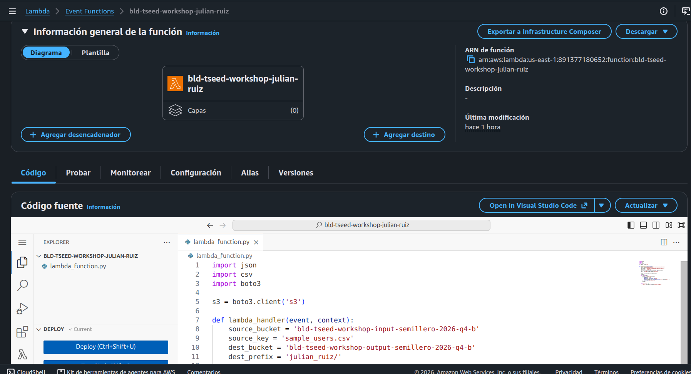
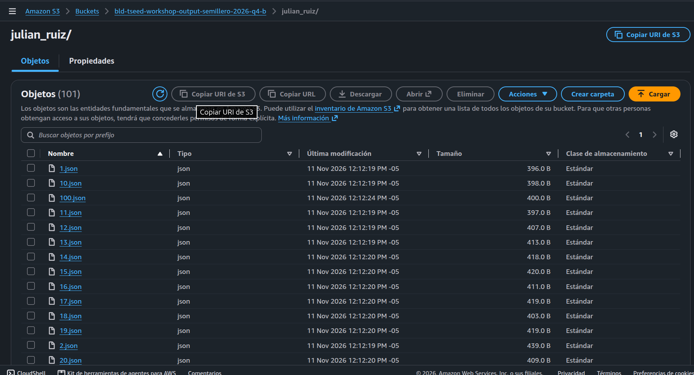
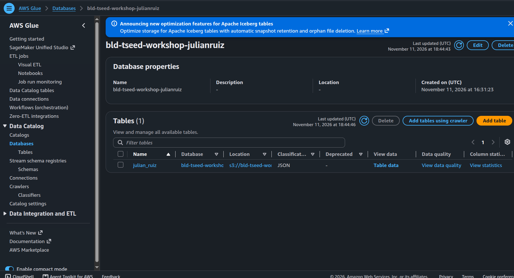
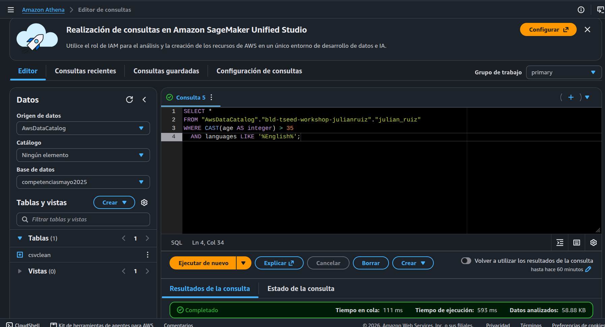

# Taller HandsOnLab1 – Julián Ruiz

Pipeline sencillo de datos en AWS: se lee un CSV desde S3, se convierte cada fila en un JSON con una función Lambda, se cataloga con un crawler de Glue y se consulta con SQL en Athena.

```
S3 (input: CSV) ──► Lambda (CSV → JSON) ──► S3 (output: JSON) ──► Glue Crawler (Data Catalog) ──► Athena (SQL)
```

## 1. Lambda: de CSV a JSON

La función `bld-tseed-workshop-julian-ruiz` lee `sample_users.csv` del bucket `bld-tseed-workshop-input-semillero-2026-q4-b` y escribe un archivo por usuario en `bld-tseed-workshop-output-semillero-2026-q4-b/julian_ruiz/`, usando el `user_id` como nombre.

Código: [`lambda/lambda_function.py`](lambda/lambda_function.py)



Cada JSON se escribe en una sola línea para que Athena pueda leerlo. Ejemplo ([`ejemplo/10.json`](ejemplo/10.json)):

```json
{"user_id": "10", "name": "Andrés Gómez", "country": "México", "city": "Santiago", "role": "Engineer", "department": "IT", "education": "PhD", "age": "39", "languages": "French", "salary": "98688", ...}
```

**Permisos:** se agregó al rol de la Lambda una política inline con `s3:GetObject` sobre el CSV de entrada y `s3:PutObject` sobre `julian_ruiz/*` en el bucket de salida.

**Resultado:** 100 archivos JSON en la carpeta `julian_ruiz/`.



## 2. Glue: catálogo de datos

Se creó la base de datos `bld-tseed-workshop-julianruiz` y un crawler *on demand* apuntando a `s3://bld-tseed-workshop-output-semillero-2026-q4-b/julian_ruiz/`. El crawler generó la tabla `julian_ruiz` (clasificación JSON) con las 17 columnas del CSV.



## 3. Athena: consultas SQL

El crawler dejó todas las columnas como `string`, por eso `age` se convierte con `CAST` para comparar números.



| # | Consulta | Filas | Resultado |
|---|----------|-------|-----------|
| 1 | Consulta general de la tabla | 68 | [`consulta1_general.csv`](resultados/consulta1_general.csv) |
| 2 | Personas de Berlín con educación Bachelor | 0 | [`consulta2_berlin_bachelor.csv`](resultados/consulta2_berlin_bachelor.csv) |
| 3 | Personas que hablan inglés y tienen más de 35 años | 19 | [`consulta3_ingles_mayores_35.csv`](resultados/consulta3_ingles_mayores_35.csv) |

```sql
-- Consulta 2: Berlín + Bachelor
SELECT *
FROM "AwsDataCatalog"."bld-tseed-workshop-julianruiz"."julian_ruiz"
WHERE city LIKE '%Berlin%'
  AND education LIKE '%Bachelor%';

-- Consulta 3: inglés + mayores de 35
SELECT *
FROM "AwsDataCatalog"."bld-tseed-workshop-julianruiz"."julian_ruiz"
WHERE CAST(age AS integer) > 35
  AND languages LIKE '%English%';
```

La consulta 2 no devuelve filas porque en el dataset no hay usuarios en Berlín (las ciudades son Bogotá, Medellín, Lima, Santiago, Buenos Aires, Ciudad de México, Madrid y Barcelona).

## Problemas resueltos en el camino

- **`AccessDenied` en `GetObject`/`PutObject`:** la política del rol usaba nombres de bucket genéricos; se corrigió con los ARN exactos.
- **Clave sin `/`:** el prefijo `julian_ruiz` sin barra generaba `julian_ruiz1.json`, fuera del permiso; se corrigió a `julian_ruiz/`.
- **`HIVE_CURSOR_ERROR` en Athena:** los JSON con `indent=2` ocupaban varias líneas; se cambió a un JSON por línea.
- **`SCHEMA_NOT_FOUND`:** se usó el nombre completo `"AwsDataCatalog"."bld-tseed-workshop-julianruiz"."julian_ruiz"`.

## Estructura

```
├── README.md
├── lambda/lambda_function.py
├── ejemplo/10.json
├── resultados/        # CSV exportados desde Athena
└── imagenes/          # Pantallazos de S3, Lambda, Glue y Athena
```
